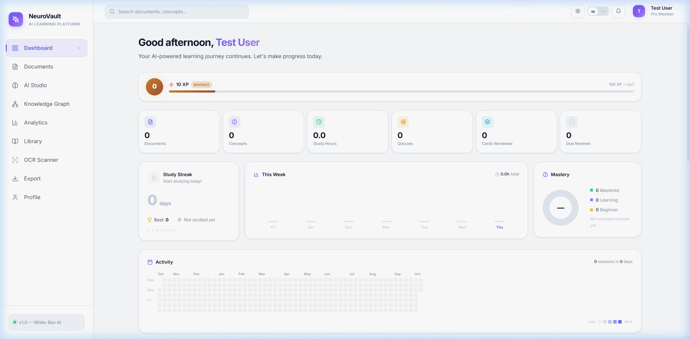

<div align="center">

# 🧠 NeuroVault

**AI-powered learning platform that turns your study documents into an interactive tutor.**

Upload a PDF or Word file → chat with it, get cited answers, generate quizzes & flashcards, explore a knowledge graph, and follow an adaptive study plan — all running **locally**, with no external AI APIs.




</div>

---

## ✨ Features

### 📄 Documents
- Upload **PDF, DOCX, TXT, Markdown** — or scan an **image with OCR** (Vietnamese + English)
- Built-in PDF / text viewer with **annotations**
- Publish documents to a **community library** (like & rate)

### 🤖 AI study tools
- **RAG chat with source citations** — streamed answers grounded in your document
- **Socratic AI tutor** — a multi-agent system (Tutor, Assessment, Feedback, Path-Planning, Safety)
- **Quiz generator** — MCQ, fill-in-the-blank, true/false, Bloom's taxonomy levels
- **Adaptive quiz** — Item Response Theory (Rasch model) adjusts difficulty after every answer
- **Flashcards** with **FSRS** spaced repetition (Again / Hard / Good / Easy)
- **Knowledge graph** — auto-extracted concepts and relations, interactive visualisation
- **Summaries** — TextRank + MMR extractive, with optional LLM rewrite
- **Learning path & study plan** — prerequisite ordering + knowledge tracing

### 📈 Progress & motivation
- Dashboard: streak, weekly chart, mastery donut, 1-year activity heatmap
- Analytics: study & quiz trends, concept mastery table, predictions
- Gamification: XP, levels, tiers, badges, daily challenge, leaderboard
- Smart notifications (cards due, streak at risk, mastery drop) via SSE

### 🧩 Platform
- Email/password + **Google OAuth** login (JWT access + refresh tokens)
- **English / Vietnamese** UI, light / dark theme, voice input & read-aloud
- **PWA** — installable, works offline
- Export to **Anki / CSV / Markdown / JSON backup**, flashcard import

---

## 🏗️ Architecture

```
┌──────────────────────┐     REST / SSE      ┌──────────────────────┐     HTTP      ┌──────────────────────┐
│  Frontend (React)    │ ──────────────────▶ │  API Gateway (Node)  │ ────────────▶ │  AI Core (FastAPI)   │
│  Vite · Zustand · PWA│ ◀────────────────── │  Express · JWT · WS  │ ◀──────────── │  RAG · NLP · Agents  │
│  :5173               │                     │  :5001               │               │  :8000               │
└──────────────────────┘                     └──────────┬───────────┘               └──────────┬───────────┘
                                                        │                                      │
                                                 ┌──────▼──────┐                        ┌──────▼──────┐
                                                 │  MongoDB    │                        │  Ollama     │
                                                 │  :27017     │                        │  :11434     │
                                                 └─────────────┘                        └─────────────┘
```

**Document pipeline:** parse (PyMuPDF / python-docx) → clean → sentence split → semantic chunking → TF-IDF + Truncated SVD embeddings → BM25 + vector index → concept extraction → knowledge graph.

**Retrieval:** query reformulation → hybrid BM25 + vector search fused with Reciprocal Rank Fusion → reranking → grounded generation via a local LLM (default `qwen3:1.7b`).

### "White-box" AI
Most of the AI is implemented from scratch in Python + NumPy, without PyTorch, scikit-learn, LangChain or a vector database:
embeddings, vector store, BM25, reranker, semantic chunker, BPE tokenizer, Vietnamese word segmentation, knowledge graph (PageRank, label propagation), FSRS, IRT, deep knowledge tracing and the multi-agent orchestrator. The only neural model is the LLM served by Ollama.

---

## 🛠️ Tech stack

| Layer | Technologies |
|---|---|
| Frontend | React 18, Vite 5, React Router 6, Zustand, lucide-react, react-markdown, vite-plugin-pwa |
| API Gateway | Node.js 20, Express 4, Mongoose 8, JWT, Passport (Google OAuth), ws, Multer, Tesseract.js, Helmet, express-rate-limit |
| AI Core | Python 3.11, FastAPI, Uvicorn, NumPy, SciPy, PyMuPDF, python-docx, httpx |
| LLM | Ollama (local) |
| Database | MongoDB 7 |
| DevOps | Docker Compose, Nginx |

---

## 🚀 Getting started

### Prerequisites
- Node.js 20+
- Python 3.11
- MongoDB (optional — falls back to an in-memory database for local dev)
- [Ollama](https://ollama.com/download) (optional — needed for chat/LLM generation)

### 1. Install

```bash
git clone git@github.com:LeeTuaans1594/neurovault.git
cd neurovault

# Frontend
cd frontend && npm install && cd ..

# API Gateway
cd backend/server && npm install && cd ../..

# AI Core
cd backend/ai_core
python -m venv .venv
.venv\Scripts\pip install -r requirements.txt      # Windows
# source .venv/bin/activate && pip install -r requirements.txt   # macOS / Linux
cd ../..
```

Optional LLM:
```bash
ollama pull qwen3:1.7b
```

### 2. Run

**Windows (one click):**
```bash
dev.bat
```

**Manually (3 terminals):**
```bash
# AI Core
cd backend/ai_core && .venv\Scripts\python api/ai_server.py

# API Gateway  (use `npm start` if MongoDB is running locally)
cd backend/server && npm run local

# Frontend
cd frontend && npm run dev
```

Open **http://localhost:5173** · Health check: http://localhost:5001/api/health

### 3. Docker

```bash
docker compose --env-file .env.production up -d --build
```
Frontend → http://localhost:3000

---

## ⚙️ Configuration

Create `backend/server/.env` (see `backend/server/.env.example`):

| Variable | Default |
|---|---|
| `PORT` | `5001` |
| `MONGODB_URI` | `mongodb://127.0.0.1:27017/neurovault` |
| `JWT_SECRET`, `JWT_REFRESH_SECRET` | dev fallbacks — **change in production** |
| `AI_CORE_URL` | `http://127.0.0.1:8000` |
| `OLLAMA_URL` / `LLM_MODEL` | `http://127.0.0.1:11434` / `qwen3:1.7b` |
| `GOOGLE_CLIENT_ID`, `GOOGLE_CLIENT_SECRET` | empty (Google login disabled) |
| `CLIENT_URL` | `http://localhost:5173` |

---

## 📁 Project structure

```
neurovault/
├── frontend/              React SPA
│   └── src/
│       ├── pages/         Dashboard, Documents, AI Studio, Knowledge Graph, Analytics, Library, OCR, Export, Profile …
│       ├── components/    chat, quiz, flashcard, knowledge, analytics, dashboard, gamification …
│       ├── store/         Zustand stores
│       ├── services/      API client
│       └── i18n/          EN / VI
├── backend/
│   ├── server/            Express API gateway (routes, models, middleware, services, WebSocket)
│   └── ai_core/           FastAPI AI engine
│       ├── preprocessing/ nlp/ tokenizer/ embedding/ retrieval/
│       ├── inference/     RAG pipeline, LLM engine
│       ├── knowledge/     concepts, knowledge graph
│       ├── generation/    quiz, flashcards, summary
│       ├── adaptive/      FSRS, IRT adaptive quiz, knowledge tracing
│       ├── learning/      learning path, smart notifications
│       └── agents/        orchestrator + tutor / assessment / feedback / path-planning / safety
├── docker-compose.yml
└── dev.bat
```

---

## 👤 Author

**Lê Đào Anh Tuấn** — [@LeeTuaans1594](https://github.com/LeeTuaans1594)