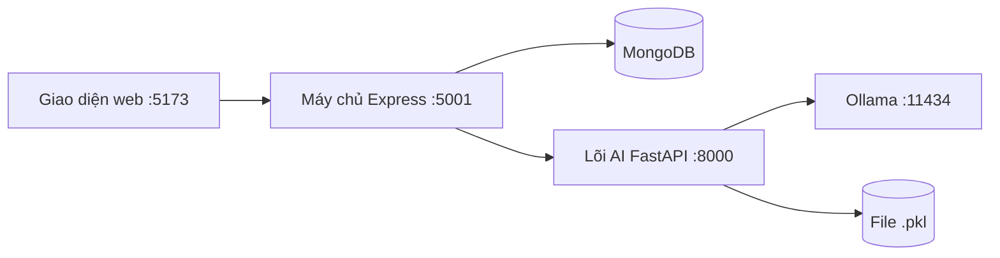

# Giai đoạn 1 — Bản đồ mã nguồn (cũ → mới)

> Mục đích: ghi lại hệ thống hiện tại **trước khi sửa**, và quyết định số phận từng phần.
> Tài liệu này không thay đổi code. Điểm quay lại an toàn: tag `v1.0-baseline`.

## 1. Hệ thống gồm những gì



- **Giao diện:** 10 trang (Dashboard, Tài liệu, Chi tiết tài liệu, AI Studio, Đồ thị tri thức, Thống kê, Thư viện, OCR, Xuất file, Hồ sơ).
- **Máy chủ Express:** 14 nhóm API, lo đăng nhập, lưu tài liệu, chuyển yêu cầu sang lõi AI.
- **Lõi AI:** dồn hết vào 1 file ~1.300 dòng, 30 API, lưu dữ liệu bằng file `.pkl`.

## 2. Ký hiệu

| Ký hiệu | Nghĩa |
|---|---|
| ✅ GIỮ | Dùng tiếp, không sửa |
| 🔧 SỬA | Giữ lại nhưng chỉnh cho hợp hệ mới |
| 🔄 THAY | Viết mới hoàn toàn (đây là chỗ gây kết quả kém) |
| 🙈 ẨN | Giữ nguyên code, chỉ ẩn khỏi giao diện (không xoá) |
| 🗑️ XOÁ? | Có thể xoá ở giai đoạn 7 — **phải hỏi bạn trước** |

## 3. Lõi AI — từng phần sẽ làm gì

| Phần | Đang làm gì | Vấn đề | Quyết định |
|---|---|---|---|
| Đọc PDF/DOCX | Lấy chữ thô | Mất tiêu đề, mục lục, số trang | 🔄 THAY — đọc giữ cấu trúc chương/mục |
| Làm sạch chữ | Bỏ ký tự rác | Ổn | ✅ GIỮ |
| Tách câu | Tách bằng quy tắc | Sai với tiếng Việt | 🔧 SỬA — dùng Underthesea |
| Nhận diện ngôn ngữ | Việt / Anh | Ổn | ✅ GIỮ |
| Chia đoạn (chunk) | Cắt theo độ dài | Cắt ngang qua các mục | 🔄 THAY — chia theo từng mục |
| Xử lý tiếng Việt | Quy tắc tự viết | Tách sai từ ghép ("học máy" → "học" + "máy") | 🔄 THAY — Underthesea |
| Bộ tách từ BPE tự viết | Thử nghiệm | Không dùng thật | 🗑️ XOÁ? |
| Biến chữ thành vector | TF-IDF riêng từng tài liệu | Không so sánh được giữa các tài liệu | 🔄 THAY — mô hình `bge-m3` |
| Tìm kiếm từ khoá BM25 | Tìm theo từ | Tách từ kém | 🔧 SỬA |
| Kho vector | Trong RAM | Mất khi tắt máy | 🔄 THAY — Qdrant |
| Gộp điểm tìm kiếm | Cộng điểm | Ý tưởng ổn | 🔧 SỬA — lọc theo tài liệu được chọn |
| "Reranker" | Giả lập | Không phải reranker thật | 🗑️ XOÁ? |
| Trích khái niệm | Cụm từ + TF-IDF | Lấy ra mẩu vụn, cụm vô nghĩa | 🔄 THAY — cụm danh từ + mô hình xếp hạng tự huấn luyện |
| Đồ thị tri thức | Đếm từ xuất hiện cùng nhau | Quan hệ không có ý nghĩa thật | 🔄 THAY — cây theo mục lục + AI tìm quan hệ, có dẫn chứng |
| Gom chủ đề | KMeans | Phụ thuộc vector cũ | 🔧 SỬA |
| Gộp nhiều tài liệu | So tên giống nhau | Quá đơn giản | 🔧 SỬA (làm sau) |
| Gọi AI (LLM) | Chỉ Ollama | Gắn chết 1 loại | 🔧 SỬA — Gemini chính, Ollama dự phòng |
| RAG (hỏi đáp) | Tìm rồi hỏi AI | Không trích nguồn, không kiểm tra | 🔄 THAY — lập dàn ý → tìm → viết → kiểm chứng → trích nguồn |
| Tóm tắt | Trích câu | Không có nguồn | 🔄 THAY — tóm tắt, ghi chú, dàn ý, thuật ngữ |
| Quiz, flashcard | Tạo câu hỏi mẫu | Ngoài phạm vi mới | 🙈 ẨN |
| Học thích ứng, agent, lộ trình học | Tính năng lớp học | Ngoài phạm vi mới | 🙈 ẨN |
| File API chính | Chứa tất cả | Quá lớn, khó bảo trì | 🔧 SỬA — giữ API cũ, thêm API mới `/api/v2` bên cạnh |

## 4. API cũ — vẫn chạy bình thường đến giai đoạn 7

| API | Quyết định |
|---|---|
| `/health`, `/api/stats` | ✅ GIỮ |
| `/api/process` (xử lý tài liệu) | Chạy cũ hoặc mới tuỳ công tắc `PIPELINE_VERSION`, kết quả **cùng định dạng** |
| `/api/knowledge-graph` | Như trên |
| `/api/concepts`, `/api/summary` | Dùng hệ mới khi bật |
| Chat, quiz, flashcard, học thích ứng, agent, lộ trình | 🙈 ẨN |
| Gộp nhiều tài liệu | 🔧 SỬA sau |

**API mới** (thêm vào, không đè lên cái cũ) — nằm dưới `/api/v2`:
xử lý tài liệu · xem cây mục lục · xem khái niệm · đồ thị theo nhiều tài liệu ·
tạo bài tập / tóm tắt / ghi chú / dàn ý / thuật ngữ · xuất PDF / DOCX / Markdown.

## 5. Máy chủ Express

| Nhóm | Quyết định |
|---|---|
| Đăng nhập, Tài liệu, OCR | ✅ GIỮ |
| Chuyển tiếp AI | ✅ GIỮ + thêm đường cho API mới (giai đoạn 5) |
| Xuất file | 🔧 SỬA — thêm xuất PDF/DOCX/MD cho nội dung AI tạo |
| Học tập, thống kê, gamification, thư viện, giảng viên, cộng tác, thông báo, chú thích, giám sát | 🙈 ẨN |

Dữ liệu cũ trong MongoDB **không đụng tới**. Hệ mới lưu thêm vào bảng riêng.

## 6. Giao diện

- Đồ thị tri thức mới trả về **đúng định dạng cũ** → giao diện hiện tại vẫn chạy.
- Có thêm: dẫn chứng (trang + câu trích) và vị trí mục.
- Giai đoạn 5 chỉ hiện: Tài liệu, Chi tiết, Đồ thị, AI Studio, Xuất file. Các trang khác ẩn.

## 7. Cấu trúc thư mục mới (giai đoạn 3)

```
backend/ai_core/
  domain/          khái niệm cốt lõi (tài liệu, mục, đoạn, khái niệm, cây, quan hệ)
  application/     các chức năng (xử lý, dựng cây, dựng đồ thị, tạo nội dung, xuất file)
  infrastructure/  kết nối bên ngoài (MongoDB, Qdrant, Ollama, Gemini, đọc file, tiếng Việt)
  api/             API cũ + API mới v2
  tests/           kiểm thử
```

## 8. Cách quay lại khi có lỗi

| Mức | Cách làm |
|---|---|
| Nhanh nhất | Đặt `PIPELINE_VERSION=legacy` trong `.env` → dùng lại hệ cũ |
| Code | Quay về tag `v2.0-stageN` hoặc `v1.0-baseline` |
| Dữ liệu | File backup `.zip` + sao lưu MongoDB trước khi chuyển dữ liệu |
