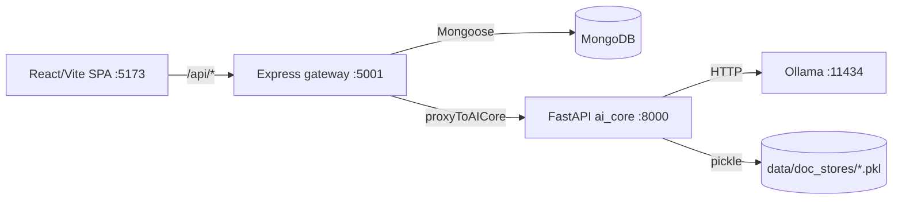

# Stage 1 — Codebase Map (legacy → v2)

> Purpose: freeze a factual picture of the legacy system **before** any refactor, and decide the
> fate of every module. Nothing here changes behaviour. Baseline tag: `v1.0-baseline`.

## 1. Runtime topology



| Service | Entry | Notes |
|---|---|---|
| Frontend | `frontend/src/App.jsx` | 10 protected routes + login/register/google callback |
| Gateway | `backend/server/index.js` | 14 routers under `/api/*`; `start-local.js` = in-memory Mongo |
| AI core | `backend/ai_core/api/ai_server.py` | 1 file, ~1.3k lines, 30 endpoints, global in-memory stores |

## 2. AI core module inventory and v2 fate

Legend — **KEEP** reuse as is · **ADAPT** wrap behind a port · **REPLACE** new v2 implementation ·
**FLAG** keep, hidden behind feature flag (no deletion) · **PURGE?** candidate for Stage 7 removal (needs approval).

| Module | Lines | Role today | Root-cause issue | v2 fate |
|---|---:|---|---|---|
| `preprocessing/pdf_parser.py` | 287 | PDF/DOCX/TXT → flat text | Drops headings, TOC, page per block | **REPLACE** → structural parser (`DocumentAST`) |
| `preprocessing/text_cleaner.py` | 120 | Whitespace/noise cleanup | OK | **KEEP** |
| `preprocessing/sentence_splitter.py` | 138 | Regex sentence split | Weak on VI abbreviations | **ADAPT** (Underthesea `sent_tokenize` for VI) |
| `preprocessing/language_detector.py` | 188 | VI/EN heuristic | OK | **KEEP** |
| `preprocessing/semantic_chunker.py` | 300 | Fixed/semantic chunks | Ignores sections; chunks cross headings | **REPLACE** → section-aware chunker |
| `nlp/vietnamese.py` | 360 | Hand rules for VI | No word segmentation → compounds split | **REPLACE** → Underthesea adapter |
| `tokenizer/bpe_tokenizer.py` | 448 | Toy BPE (vocab 902) | Not used for quality | **PURGE?** |
| `embedding/embedding_engine.py` | 329 | TF-IDF + SVD, fitted **per document** | Single-doc IDF, not comparable across docs | **REPLACE** → Ollama `bge-m3` embeddings |
| `retrieval/bm25.py` | 126 | BM25 | OK, but tokenization naive | **ADAPT** (segmented tokens) |
| `retrieval/vector_store.py` | 101 | In-memory numpy store | Lost on restart, rebuilt from pkl | **REPLACE** → Qdrant embedded |
| `retrieval/hybrid_ranker.py` | 77 | Score fusion | OK idea | **ADAPT** → RRF + doc-scope filter |
| `retrieval/cross_encoder_reranker.py` | 184 | Heuristic "reranker" | Not a real cross-encoder | **PURGE?** (optional LLM rerank later) |
| `knowledge/concept_extractor.py` | 563 | n-gram + TF-IDF concepts | Picks fragments/stop phrases | **REPLACE** → NP candidates + YAKE + embedding MMR + learned ranker |
| `knowledge/graph_builder.py` | 848 | Co-occurrence + regex relations, PageRank | Edges are statistical, LLM disabled | **REPLACE** → deterministic tree + LLM semantic edges (evidence-cited) |
| `knowledge/topic_clusterer.py` | 179 | KMeans on SVD | Depends on per-doc SVD | **ADAPT** (on bge-m3 vectors) |
| `knowledge/cross_document.py` | 297 | Merge graphs by name | String match only | **ADAPT** (embedding alignment) — later |
| `inference/llm_engine.py` | 860 | Ollama client + prompts | Hardwired to one backend | **ADAPT** → `LLMPort` (Gemini primary, Ollama fallback) |
| `inference/rag_pipeline.py` | 603 | Retrieve → prompt | No citation / verification | **REPLACE** → plan→retrieve→draft→verify→cite |
| `inference/topic_tracker.py` | 327 | Chat topic tracking | Chat feature | **FLAG** |
| `generation/summary_generator.py` | 325 | Extractive summary | No grounding/citation | **REPLACE** (v2 summary/notes/outline/glossary) |
| `generation/quiz_generator.py` | 1028 | Template MCQs | Classroom feature | **FLAG** (v2 "exercises + answer key" is new) |
| `generation/flashcard_generator.py` | 380 | Flashcards | Classroom feature | **FLAG** |
| `adaptive/*` (4 files) | 1775 | FSRS, SM-2, DKT, adaptive quiz | Out of new scope | **FLAG** |
| `agents/*` (13 files) | 4.3k | Multi-agent tutor | Out of new scope | **FLAG** |
| `learning/*` | 622 | Path optimizer, notifications | Out of new scope | **FLAG** |
| `api/ai_server.py` | 1339 | All endpoints + global state | God file, pickle persistence | **ADAPT** — legacy routes stay; new `api/v2` router mounted beside it |

## 3. AI core API contract (legacy, must stay working until Stage 7)

| Method | Path | Called by gateway | v2 status |
|---|---|---|---|
| GET | `/health` | yes | keep; now reports `pipeline_version` |
| GET | `/api/stats` | yes | keep |
| POST | `/api/process` | `document.controller.js`, `ocr.routes.js` (timeout 120 s) | **routed by `PIPELINE_VERSION`**; same response shape |
| POST | `/api/chat`, `/api/chat/stream` | yes | FLAG |
| POST | `/api/knowledge-graph` | yes | **routed by `PIPELINE_VERSION`**; same graph shape (see §5) |
| GET | `/api/concepts/{document_id}` | yes | v2-backed when enabled |
| POST | `/api/summary` | yes | v2-backed when enabled |
| POST | `/api/quiz`, `/api/flashcards`, `/api/flashcards/{due,review}`, `GET /api/flashcards/stats/{id}` | yes | FLAG |
| POST | `/api/spaced-repetition/review`, `/api/adaptive-quiz/*`, `/api/adaptive-difficulty`, `/api/knowledge-trace/*` | partly | FLAG |
| POST | `/api/learning-path`, `/api/learning-path/next`, `/api/study-plan`, `/api/smart-notifications/check` | yes | FLAG |
| POST/WS | `/api/agent/ask`, `/api/agent/ask/stream`, `/api/agent/ws`, `GET /api/agent/status` | yes | FLAG |
| POST | `/api/cross-document/merge`, `/api/cross-document/related` | yes | ADAPT later (multi-doc) |

**New in v2 (additive, under `/api/v2`, envelope `{success, data, error, meta}`):**
`POST /documents/{id}/process`, `GET /documents/{id}/tree`, `GET /documents/{id}/concepts`,
`POST /graph` (scope = list of doc ids), `POST /generate/{exercises|summary|notes|outline|glossary}`,
`GET /artifacts/{id}/export?format=pdf|docx|md`.

## 4. Gateway (Express) map

| Router | Mount | Fate |
|---|---|---|
| `auth.routes.js` | `/api/auth` | KEEP |
| `document.routes.js` + `document.controller.js` | `/api/documents` | KEEP; add multi-select scope later |
| `ai.routes.js` (proxy, 24 routes) | `/api/ai` | KEEP; add `/api/ai/v2/*` proxy in Stage 5 |
| `export.routes.js` | `/api/export` | ADAPT (add PDF/DOCX/MD of generated artifacts) |
| `ocr.routes.js` | `/api/ocr` | KEEP |
| `learning`, `analytics`, `gamification`, `library`, `instructor`, `collab`, `notification`, `annotation`, `monitor` | various | FLAG (UI hidden) |

Mongo `Document` model stores `raw_text, language, chunks, metadata` from `/api/process`. v2 adds
collections owned by ai_core (`doc_ast`, `concepts`, `artifacts`) — the gateway model is untouched.

## 5. Frontend contract that v2 must honour

- `KnowledgeGraphView` reads `data.graph.nodes | edges | stats`.
- Node: `{concept, definition, related_chunk_ids, centrality_score, pagerank, tfidf_score, frequency, community, semantic_cluster}`
- Edge: `{source, target, relation_type, relation, weight, npmi, evidence_chunk}`
- Top-level: `stats, cluster_names, prerequisite_order`.
- v2 fills the same keys (scores renamed internally, mapped at the API edge) and **adds** `evidence` (page + quote) and `section_path`.

Pages: Dashboard, Documents, DocumentDetail, AIStudio, KnowledgeGraph, Analytics, Library, OCR, Export, Profile.
Stage 5 keeps Documents / DocumentDetail / KnowledgeGraph / AIStudio / Export visible; others behind flags.

## 6. Target layout (Stage 3)

```
backend/ai_core/
  domain/          entities (DocumentAST, SectionNode, Block, Chunk, Concept, TreeNode, SemanticEdge) + ports
  application/     use_cases (process_document, build_tree, build_graph, generate_artifact, export_artifact)
  infrastructure/  config (pydantic-settings), container, mongo repos, qdrant store,
                   ollama embeddings, gemini/ollama LLM adapters, parsers, vi_nlp (underthesea)
  api/
    ai_server.py   legacy (untouched routes) + mounts v2 router + PIPELINE_VERSION switch
    v2/            new router, schemas, StandardAPIResponse
  tests/           smoke (legacy) · unit · baseline · integration
```

## 7. Rollback

| Layer | How |
|---|---|
| Runtime | `PIPELINE_VERSION=legacy` in `backend/ai_core/.env` |
| Code | `git revert <merge>` or `git reset --hard v2.0-stageN` / `v1.0-baseline` |
| Data | `backups/doc_stores-*.zip`; `mongodump` before any migration |
